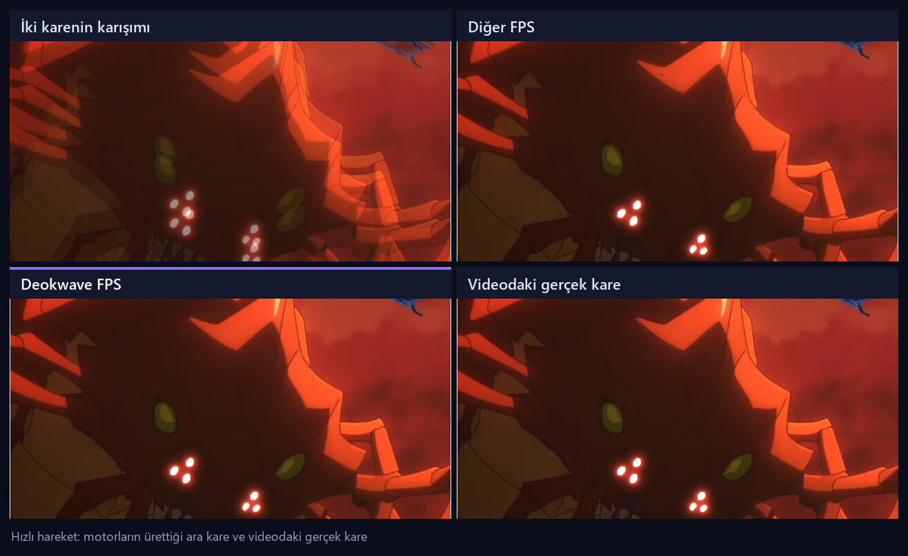
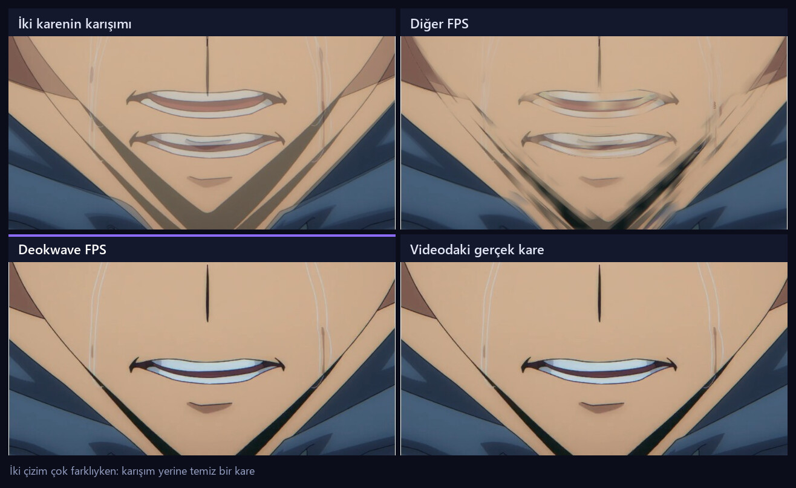

Animeler çoğunlukla saniyede 24 kare yayınlanıyor. Frame Generation, sitede "FPS Artırma" diye geçen özellik, iki kare arasına yeni kareler üretip bölümü daha akıcı oynatıyor. Hedef kare hızını sen seçiyorsun (varsayılanı 60). Kalite modu olarak Dengeli, Akıcı ve Ultra Akıcı var; bilgisayarın zorlanırsa Dengeli'de kal.

## Başlangıç

Animede ara kare üretmek filmdekinden zor, çünkü sahnelerin çoğu aynı çizimin birkaç kare tekrar etmesiyle ilerliyor. Hızlı sahnelerde iki kareyi birbirine karıştırmak da ekranda çift görüntü yapıyor.

İşe diğer FPS çözümlerinin ekranda gerçekte ne yaptığını ölçerek başladık. 200 fps hedefte 130-136 fps civarında kalıyorlardı, 28 saniyelik bir testte yüzlerce kez takılıyorlardı ve karelerin ekrana çıkış zamanı olması gerekenden 3-5 ms sapıyordu. 120 ve 144 Hz ekranlarda da düzenli takılmalar vardı.

## Geliştirme

Akıcılığı gözle değil ölçerek ayarlamak için 64 saniyelik, sabit hızla kayan test klipleri hazırladık. Ekranda çizilen her karenin videonun hangi anına ait olduğunu okuyan bir düzenek kurduk ve 60, 120, 144 ve 200 Hz ekranlarda tek tek ölçtük.

En çok uğraştıran sorun 120 ve 144 Hz ekranlardaki takılmaydı. Sebebini Chrome'da bulduk: 23,976 fps bir video bu ekranlara tam oturduğunda tarayıcı kareleri yavaş yavaş öne kaydırıyor, kayma yaklaşık 20,8 ms'yi geçince de bir kareyi fazladan gösteriyor. Bu 120 Hz'de 40,8 saniyede, 144 Hz'de 30,2 saniyede bir oluyordu. Motor artık bu anı önceden tahmin ediyor.

Bir diğer adım hareket analizini birkaç ekran yenilemesine bölmek oldu. Önceden analiz bitmeden kare çizilemiyordu; şimdi her kare zamanında çiziliyor, analiz aradaki boşlukta ilerliyor.

Kendimizi kandırmamak için de kurallar koyduk. Ayar seçerken baktığımız örnekleri sonuç diye göstermiyoruz, hiç bakmadığımız ve eşit aralıklarla seçilmiş anlarda ölçüyoruz. Aynı çizimin tekrar ettiği kareleri ayrı sayıyoruz, çünkü orada "doğru ara kare" diye bir şey yok.

## Sonuç

Yukarıda iki an var, her birinde aynı ara kare dört şekilde. İlkinde hızlı bir hareket var. İkincisinde iki çizim birbirinden o kadar farklı ki diğer FPS iki ağzı üst üste bindiriyor, biz videodaki gerçek kareyi gösteriyoruz. Gerçek kareye yakınlık ilkinde 42,6 dB'ye 35,8 dB, ikincisinde 57,4 dB'ye 20,7 dB. Her an böyle değil; ışığın iki kare arasında sertçe değiştiği sahnelerde ölçümde diğer çözümün önde çıktığı anlar da var.

Karelerin olması gereken andan sapması 0,04-0,09 ms'ye indi. 200 Hz ekranda 200 fps hedefte gerçekten 200 fps veriyor, kareler arasındaki aralıkların %99,9'u tam 5 ms. 120 ve 144 Hz'deki takılma tamamen gitti. 20 dakikalık kesintisiz oynatma testinde yaklaşık 240 bin karenin hiçbiri hazır olmadan ekrana gitmedi.

Hâlâ geride olduğumuz bir yer var: gecikme. 200 Hz ekranda yaklaşık 47 ms, diğer çözümler bunu 1-3 ms daha düşük tutuyor ama takılma pahasına. Bu farkı kapatmak şu an en çok çalıştığımız konu. Hızlı sahnelerde yarı saydam yazıların ilk birkaç karesi de üzerinde çalıştığımız bir şey; bozuk bir kare görürsen Discord'dan bölümü ve dakikayı yazman çok işimize yarar.

Kod bu depoda yok, Deokwave kapalı kaynak.

[deokwave.com](https://deokwave.com) · [Discord](https://discord.gg/deokwave) · [Deokwave GitHub](https://github.com/Deokwave)
